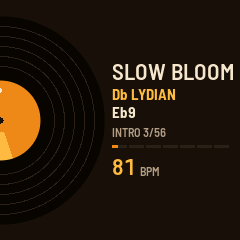
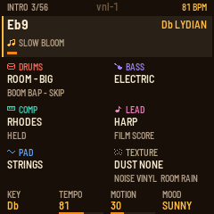
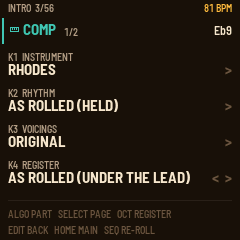

# VNL

VNL-1 is a lo-fi hip hop machine for the M-VAVE FM-1. It writes and plays its own songs, one after another, each with
its own key, tempo, chords, layout and band. You can leave it running, or steer it: change the key, the tempo, the
mood, any part's instrument, or jump between sections. Every change lands on the next four-bar line, and the screen
shows it waiting until then.

---

## Contents

1. Install
2. The sample bank
3. The screens
4. Controls
5. The parts
6. Troubleshooting

---

## 1. Install

**Try it first:** the emulator runs the same code in the browser, with sound.

**Install from the browser:** in Chrome or Edge, connect the FM-1 by USB, open the installer and press Install. The
browser asks once to allow MIDI: allow it. Don't unplug the cable while it writes. After the firmware, the installer
offers to write the sample bank (section 2).

**Install from a terminal:** from the source, with a Python that has `mido` and `python-rtmidi`:
`python3 base/tools/fm1_install.py vnl-VERSION.fwsc`, then `python3 tools/fm1_bank.py`.

**Update mode:** hold REC while switching the FM-1 on.

**Back to the stock firmware:** the installer's last section writes M-VAVE's own firmware back.

---

## 2. The sample bank

VNL-1's sampled instruments (piano, nylon, electric and jazz guitar, cello, harp and the two room kits) live in a
sample bank, in a part of the flash that a firmware update doesn't touch. Write it once, and again only when a release
says the samples changed. The browser installer offers it after the firmware; from a terminal, `tools/fm1_bank.py`
writes it. VNL-1 must be stopped while the bank is written.

Without the bank, VNL-1 says NO SAMPLES and plays its synth instruments only.

---

## 3. The screens

**Now playing** (above): the song's layout, its key and mode, the chord playing, the section and bar, and the tempo.
HOME switches between it and the main screen; the one you used last is where HOME goes back to.

**The main screen:** the song's progress, a tile per part with its instrument and rhythm, and the four knobs: key,
tempo, motion and mood.

**A part's page:** ALGO picks a part, EDIT opens its page, SELECT steps its pages. The four knobs change that page's
settings; SEQ re-rolls only that part.

")

**Parts (ARP):** each part's notes scrolling over the song.

")

**Sections (SEL):** the song's sections. EDIT or a section's key jumps there; K1 loops the section; K2 stays on the
song instead of moving to the next one.

")

**The Mixer (FX):** a level per part, with mute and solo.

---

## 4. Controls

| Control | What it does |
| --- | --- |
| PLAY | Play or stop. After a stop, PLAY carries on from the bar it stopped in. |
| SEQ | A new song. On a part's page, re-rolls only that part. |
| K1-K4 | On the main screen: key, tempo, motion, mood. On a part's page: that page's settings. |
| ALGO | Picks a part. EDIT opens its page; SELECT steps its pages. |
| PRESET | The highlighted part's instrument (or kit). |
| OCT- / OCT+ | The comp's or the lead's register. |
| SEL | Sections. |
| ARP | Parts. |
| FX | The Mixer. |
| HOME | Switches between the now-playing screen and the main screen. |
| Lowest white keys (F G A B C) | Drums, bass, comp, lead, pad: press to mute, hold to solo. The keys' lights show which parts are playing. |

---

## 5. The parts

- **Drums:** eight kits: 808 and CR-78 (modeled machines), Crunchy, Boom-bap and Jazz machine (synth drums), Soft
  brushes, and two sampled room kits. Eight patterns and nine two-bar kick phrases.
- **Bass:** electric, sub, triangle and FM bass, with walking lines and lines that lead into the next chord.
- **Comp:** Rhodes, piano, felt piano, vibes, organ, pad, nylon guitar and electric guitar, in eight rhythms; the
  guitars strum.
- **Lead:** flute, whistle, piano, felt piano, vibes, jazz guitar, cello and harp, in eight styles. The lead states a
  motif and loops it, with mutes, filter sweeps and drop-outs.
- **Pad:** strings, a warm synth pad, organ or a vox choir, in about two songs out of three.
- **Texture:** dust, a noise bed (vinyl or tape surface, rain) and room ambience.

---

## 6. Troubleshooting

- **NO SAMPLES:** the sample bank isn't on the FM-1, or it's from another build. Write it again (section 2).
- **STOP FIRST** while writing the bank: VNL-1 was playing. Press PLAY to stop it, then write again.
- **The installer can't find the FM-1:** use Chrome or Edge, a data USB cable, and allow MIDI when asked.
- **An FM-1 that won't start:** the source's README describes the rescue (`base/bsp/tools/fm1_rescue.sh`).

VNL-1 has no Bluetooth, so the keys send no velocity or pressure.
