<!-- Contributors: update this manual with every firmware change that touches a screen, a control or what the user hears. -->

# VNL-1

VNL-1 is a lo-fi hip hop machine for the M-VAVE FM-1. It writes and plays its own songs, one after another. Each song
has its own key, tempo, chords, layout and band: drums, bass, comp, lead, pad and texture. You can leave it running,
or steer it from the FM-1's knobs and buttons. Every change to the song lands on its next four-bar line, in time.

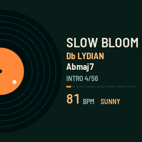

---

## Contents

1. Getting started
2. How VNL-1 plays
3. Controls on every screen
4. The screens
5. The parts' screens
6. The CPU guard
7. USB and the screen reader
8. Safe mode and update mode
9. Troubleshooting
10. The workbench

---

## 1. Getting started

VNL-1 has two pieces: the firmware and the sample bank. The sample bank holds the sampled instruments (piano, nylon
guitar, electric guitar, jazz guitar, cello, harp and the two room kits). It lives in a part of the flash that a
firmware update doesn't touch, so you write it once, and again only when a release says the samples changed.

**Try it first:** the browser emulator runs the same code, with sound, played with the mouse or the computer keyboard.

**Install from the browser:** in Chrome or Edge, connect the FM-1 by USB and open the installer. Choose "Firmware and
sample bank" the first time, then press Install. The browser asks once to allow MIDI: allow it. Don't unplug the
cable while it writes.

**Install from a terminal:** from the source, with a Python that has `mido` and `python-rtmidi`:

```
python3 base/tools/fm1_install.py vnl-1-VERSION.fwsc
python3 tools/fm1_bank.py
```

Write the bank while VNL-1 is running and stopped. If it's playing, the screen says STOP FIRST and nothing is
written. When the bank is written, the screen says SAMPLES WRITTEN.

**Without the sample bank:** VNL-1 still works. At power-on and as each song starts, the screen says NO SAMPLES,
SYNTHS ONLY, and every part plays a synth or modeled instrument instead. Write the bank to get the sampled ones.

**Back to the stock firmware:** the installer's last section writes M-VAVE's own firmware back.

---

## 2. How VNL-1 plays

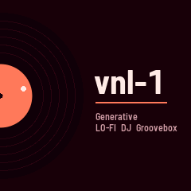

At power-on the splash shows for about a second while the record spins up, then the home screen. Press any control
to skip it. VNL-1 starts stopped, with a song ready. Press PLAY.

- **Songs:** each song has a layout of sections (intro, grooves, a lead section, breaks, an ending). When a song
  ends, 2-4 seconds of silence follow, then the next song starts.
- **Changes wait for the line:** a knob or button that changes the song doesn't act at once. The change lands on the
  song's next four-bar line. Until then the screen shows the new value with a `*` in front, in yellow, and a note
  such as TEMPO 84 IN 1 BAR. Mutes, solos, levels and the Sections screen's Loop and Stay on song act at once.
  While a section loops (or Stay on song goes back), a change due at the line where the song goes back lands as
  it starts again.
- **Stop and play:** PLAY stops the music at once. PLAY again continues the same song from the start of the bar it
  stopped in.
- **A new song:** SEQ rolls a new song. While playing, it comes after the usual silence. While stopped, it waits,
  ready, until you press PLAY.
- **While stopped:** the knobs don't change the song. Start it first.

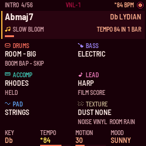

---

## 3. Controls on every screen

These work the same on every screen, unless a screen below says otherwise.

| Control | What it does |
| --- | --- |
| PLAY | Play or stop. |
| SEQ | A new song. On a part's screen, it re-rolls only that part. Hold it to lock a part or the song line (see Locking). |
| HOME | Go to the home screen. On the main screen and the now-playing screen, it switches between the two. |
| SEL | The Sections screen. SEL again goes back. |
| ARP | The Parts screen. ARP again goes back. |
| FX | The Mixer. FX again goes back. |
| GLO | The Settings screen. GLO again goes back. |
| F, G, A, B, C (the five lowest white keys) | Drums, bass, comp, lead, pad. Press to mute that part; press again to unmute. Hold to solo it; press again to unsolo. Not on the Sections screen, where the keys jump. |
| Key lights | A part's key is lit while the part plays, dark while it's muted, and blinks while it's soloed. |
| MASTER | The volume. |
| SAVE | On the Song screen, saves the song (see Saving songs). Anywhere else, shows a line of measures for a moment (the screen's redraw time, the CPU guard's level and steps, late audio blocks); on the Song screen, hold SAVE for them. Useful in a bug report. |

The other keys don't play notes. VNL-1 plays its own songs.

---

## 4. The screens

### The home: now playing or main

VNL-1 has two home screens. The main screen shows everything and starts the most. The now-playing screen is the
simple one. HOME on either switches to the other. The one you used last becomes the home: HOME from any other screen
goes there, and the FM-1 remembers it through a power-off. (It saves the choice once the music is silent, so the
save never interrupts the audio.)

**Now playing** (top of this manual): the record turns while a song plays and eases to a stop when it stops. Beside
it: the song's layout name, its key and scale, the chord playing, the section and bar, a strip with a segment for
each section, the tempo and, on its own line under the tempo, the mood.

### The main screen

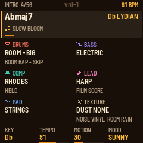

- **Status bar:** the section, the bar and the song's length in bars, LOOP while a section loops, and the tempo.
- **Song tile:** the chord playing, the key and scale, the layout name, a change on its way, and a strip of the
  song's sections.
- **Part tiles:** drums (kit and pattern), bass (instrument), comp (instrument and rhythm), lead (instrument and
  style), pad (instrument) and texture (dust, noise and room). Each in its own color.
- **Knob strip:** K1-K4 and their values, with a fill bar each.

| Control | What it does |
| --- | --- |
| K1 | Key: up or down a semitone. |
| K2 | Tempo: 70 to 90 BPM. |
| K3 | Motion: from calm (0) to busy (100), in steps of 5. |
| K4 | Mood: sad, wistful, warm or sunny. |
| ALGO or SELECT | Move the highlight through the song tile and the part tiles. |
| EDIT | Open the highlighted tile's screen. |
| PRESET | The highlighted part's instrument (the drums' kit). Past the last one it goes round to the first, and back. Nothing on the song or texture tile. |
| OCT- / OCT+ | The highlighted part's register: the comp's or the lead's. |
| SEQ, held | Lock or unlock the highlighted part, or the song line on the song tile (see Locking). A short press is a new song. |
| HOME | The now-playing screen, which becomes the home. |

### Sections (SEL)

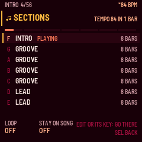

The song's sections, one a line, with their lengths. The section playing is marked PLAYING. Each line starts with the
letter of the key that jumps to it. Seven lines fit; a longer song scrolls with the highlight.

| Control | What it does |
| --- | --- |
| ALGO or SELECT | Move the highlight. |
| EDIT | Jump to the highlighted section. |
| The white keys from F up (F G A B C D E F G A) | Jump straight to the first to tenth section. The playing section's key is lit; a jump on its way blinks. |
| K1 | Loop: the section playing repeats instead of moving on. Turn either way to switch it. |
| K2 | Stay on song: the song never ends. Where the ending would start, it goes back to the section after the intro. Off by default. |
| SEL | Back. |

### Parts (ARP)


A lane for each part: drums, bass, comp, lead and pad, with the key that mutes it. Each lane shows the part's notes
over eight bars, scrolling with the song. Notes already played are in the part's color.

| Control | What it does |
| --- | --- |
| ALGO or SELECT | Pick a lane. |
| K1 | Mute the picked part (again: unmute). |
| K2 | Solo the picked part (again: unsolo). |
| ARP | Back. |

### Mixer (FX)

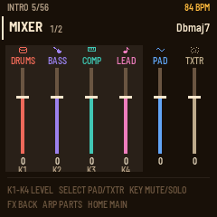

A fader for each part: drums, bass, comp, lead, pad and texture. The levels go from -12 to +6 dB and stay as you set
them from song to song. The knob that moves a fader is named under it.

| Control | What it does |
| --- | --- |
| K1-K4 | Page 1: the drums', bass's, comp's and lead's levels. Page 2: K1 the pad's, K2 the texture's. |
| SELECT or ALGO | The other page. |
| FX | Back. |

### Settings (GLO)

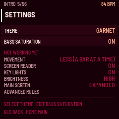

**THEME** works: turn SELECT or ALGO to step through the screen's color themes (PLUM+, the default, then OXBLOOD,
OXBLOOD+, the black ones GREEN to MONO, ESPRESSO, TEAL, OLIVE and PLUM). Every screen changes at once, the splash
too. The device keeps the theme through power-off (written once nothing is playing, as the home is) and a USB backup
holds it. The rest of the list is planned for a later version and does nothing yet. GLO goes back.

| Control | What it does |
|---|---|
| SELECT or ALGO | The next theme (turned back, the one before). |
| GLO | Back. |

---

## 5. The parts' screens

Open a part's screen from the main screen: highlight its tile with ALGO, then press EDIT. Each screen shows the part's
name and page, then a row for each knob: its name, its value, and a bar. A hint line at the bottom names the buttons.

On every part's screen:

| Control | What it does |
| --- | --- |
| K1-K4 | The settings on this page (below). Most step through choices; AS ROLLED is the song's own choice. A re-roll setting (variation, line, voicings, phrase, notes) steps through new versions of the part; its first value, ORIGINAL or AS ROLLED, is the song's own. |
| SELECT | The next page, on parts that have more than one. |
| ALGO | The next part, in this order: song, drums, bass, comp, lead, pad, texture. |
| PRESET | This part's instrument (the drums' kit). |
| SEQ | Re-roll this part only, on the next four-bar line. On the song screen, a new song; on the texture screen, nothing. Held, it locks or unlocks this part; on the song screen, the song line (see Locking). |
| OCT- / OCT+ | The register, on the comp's and the lead's screens. |
| EDIT | Back to the main screen. |

### Locking

A locked part stays as it is when a new song rolls, while everything else changes. Lock a part you like, then press
SEQ for new songs around it. The song line locks too: the key and scale, tempo, motion and mood.

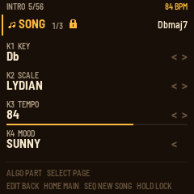

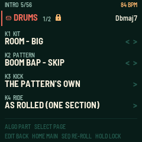

- **Lock or unlock:** hold SEQ for about half a second, on the part's screen or on the main screen with the part's
  tile highlighted. For the song line, hold it on the Song screen or with the song tile highlighted. Hold again to
  unlock. A short press still re-rolls the part (on its screen) or rolls a new song (on the main and Song screens).
- **Shown:** a padlock beside the part's name on its screen and on its tile on the main screen (the song line's on
  the song tile and beside SONG). The header says DRUMS LOCKED or DRUMS UNLOCKED for a moment, and the screen reader
  says it too.
- **What it keeps:**
  - Drums: kit, pattern, kick, ride and variation.
  - Bass: instrument and line. Its style (roots, walking, pedal) can still change with the song.
  - Comp: instrument, rhythm (strum pattern and fill too), voicings, register, and whether a busy lead thins it.
  - Lead: instrument, style, phrase, register and loop.
  - Pad: instrument, on or off, place and notes.
  - Texture: dust, noise and room.
  - The song line: key and scale, tempo, motion and mood. The chords, layout, swing and chord color still change, to
    ones that suit the kept scale and mood.
- **Changing a locked part:** the knobs still change it, and the lock keeps the change. SEQ on its screen won't
  re-roll it: the header says DRUMS IS LOCKED.
- **Instruments that can't be shared:** the felt piano, the piano and the vibes play one part a song, and organ keys
  never play under an organ pad. When a new song would clash with a lock, VNL-1 rolls another one. If both clashing
  parts are locked, the second one's instrument isn't kept for that song, and the header says LEAD LOCK, INSTRUMENT
  NOT KEPT (or PAD LOCK).
- **How long:** until you unlock it or switch the FM-1 off. Locks are never saved.

### Song

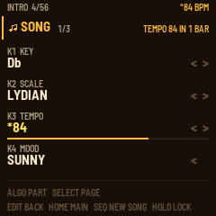

| Page | K1 | K2 | K3 | K4 |
| --- | --- | --- | --- | --- |
| 1 | Key: 12 keys | Scale: six modes, from Ionian to Aeolian | Tempo: 70-90 BPM | Mood: sad, wistful, warm, sunny |
| 2 | Motion: 0-100, calm to busy | Swing: 52-62 % | Layout: Classic, Slow bloom, Straight in, Breather or Drift | Chords: the chord progression, by number and its chords |
| 3 | Chord color: 7ths, 9ths or rich (9ths, 11ths, 13ths) | | | |

A change of layout or chords is a bigger change than the others. It still lands on the next four-bar line.

On the Song screen (every page), besides the controls above:

| Control | What it does |
| --- | --- |
| SAVE | Save the song into the first free slot. The header says SAVED TO 3 for a moment. |
| SAVE, held | The line of measures (what SAVE shows on other screens). A hold never saves. |
| REC | The Saved list (see Saving songs). |

### Saving songs

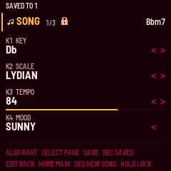

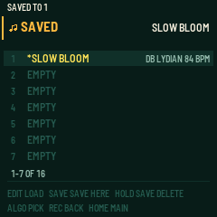

VNL-1 keeps 16 songs. A saved song comes back exactly as it was: its seed and every rolled choice (key, scale, tempo,
motion, mood, swing, layout, chords, chord color, the band's set, drum pattern, texture, length), and every change
you made to its parts (instruments, kit, rhythms, styles, registers, re-rolls). A change still waiting for its
four-bar line is saved as if it had landed.

- **Save:** press SAVE on the Song screen. The song goes into the first free slot; the header says SAVED TO 3. The
  same song saved again goes back into its own slot. With all 16 slots full, the header says NO FREE SLOT: delete
  one first.
- **The Saved list:** press REC on the Song screen (REC again goes back). Each line shows the slot, the song's name
  (its layout), its key and scale, and its tempo, or EMPTY. ALGO or SELECT moves the highlight.
- **Load:** highlight a song and press EDIT. It becomes the next song: while a song plays, that song gives way and
  the saved one starts after the usual short gap; when stopped, it is ready and PLAY starts it. The header says
  SLOT 3 IS NEXT.
- **Save into a chosen slot:** on the Saved list, highlight a slot and press SAVE. A song already there is replaced.
- **Delete:** on the Saved list, highlight a song and hold SAVE. The header says SLOT 3 DELETED.
- **While a song plays:** the FM-1 writes its memory only when everything is quiet (writing it while music plays
  makes a crackle). A song saved while music plays shows at once, in yellow with a `*`, and is written as soon as
  the music stops (or at the silence between two songs). One save can wait at a time: a second one into another slot
  says A SAVE WAITS, STOP TO SAVE MORE. Don't switch the FM-1 off before the save is written.
- **What isn't saved:** the locks, mutes, solos and mixer levels, and the Sections screen's Loop and Stay on song
  switches.
- **Over USB:** a backup holds the saved songs and the home screen (see USB and the screen reader).
  `tools/fm1_songs.py list` tags each song `[flash]` (written, kept through power-off) or `[RAM only: ...]` (not
  yet written: its save waits for silence, or its write failed and needs saving again).
- **Firmware updates:** a VNL-1 update (`fm1_install.py` with a VNL-1 package) keeps the saved songs. Going back to
  M-VAVE's stock firmware erases them (it takes that part of the memory for its own). `tools/flash.sh`, which
  installs stock first, exports the songs before it starts (into `backups/`) and writes them back at the end.

### Drums

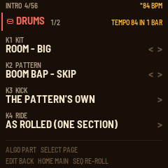

| Page | K1 | K2 | K3 | K4 |
| --- | --- | --- | --- | --- |
| 1 | Kit: Soft brushes, 808, CR-78, Crunchy machine, Boom-bap machine, Jazz machine, Room - big, Room - brushes | Pattern: three boom bap patterns, two half-time, a sparse one, brushes, a two-bar half-time | Kick: the pattern's own, or one of nine two-bar kick phrases | Ride: as rolled, none, throughout, or one section (the sampled kits) |
| 2 | Variation: a re-roll of the drums' details | | | |

### Bass

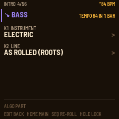

| K1 | K2 |
| --- | --- |
| Instrument: electric, sub, triangle or FM | Line: a re-roll of the bass line |

Every bass but the sub is gently saturated, so its line carries on small speakers; the sub stays clean.

### Comp

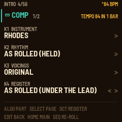

| Page | K1 | K2 | K3 | K4 |
| --- | --- | --- | --- | --- |
| 1 | Instrument: Rhodes, felt piano, nylon guitar, pad, vibes, organ, piano, electric guitar | Rhythm: held, half notes, stabs, held on 2, held on 2 and 4, charleston, tresillo, late one, strum | Voicings: a re-roll of the chord voicings | Register: down an octave, as rolled, up an octave |
| 2 | Strum fill: default, step back or drive (the guitars' strums) | Busy lead thins: on or off. On, the comp plays less while the lead is busy | Over a low lead: as rolled, lift over it or with the lead (the jazz guitar's and the cello's sets) | |

With a guitar on the comp, Rhythm picks a strum pattern instead: D-DU-UDU, chuck, bossa, ballad, offbeat-skank,
syncopated-push, anticipation or charleston. OCT- and OCT+ step the register too.

Over a low lead (the jazz guitar or the cello), the comp either lifts an octave while the lead plays or stays in its
own register with the lead, leaving out a note and dipping under it where the lead sounds. A song rolls with the
lead three times in four; Over a low lead forces either.

### Lead

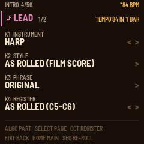

| Page | K1 | K2 | K3 | K4 |
| --- | --- | --- | --- | --- |
| 1 | Instrument: felt piano, flute, vibes, piano, jazz guitar, cello, harp, whistle | Style: Impressionism, Romanticism, '60s Jazz, Modal Jazz, Jazz-Hop, Film Score, Bossa Nova, Ambient | Phrase: a re-roll of the lead's motif | Register: down an octave, as rolled, up an octave |
| 2 | Loop: default, off or on. On, the lead loops its motif the way a producer loops a sample | | | |

The lead plays in the song's lead sections. It states a motif and comes back to it. OCT- and OCT+ step the register
too.

### Pad

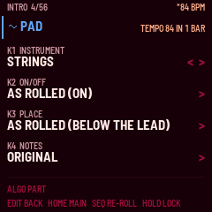

| K1 | K2 | K3 | K4 |
| --- | --- | --- | --- |
| Instrument: organ, strings, pad or vox | On/off: as rolled, off or on. About two songs out of three have a pad | Place: as rolled, below, with or above the lead | Notes: a re-roll of the pad's notes |

### Texture

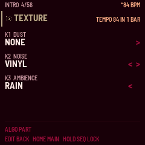

| K1 | K2 | K3 |
| --- | --- | --- |
| Dust: none, light, medium or heavy | Noise: none, vinyl or tape surface | Ambience: none or rain |

The noise bed fades in as a song starts and out as it ends.

---

## 6. The CPU guard

The FM-1 has a fixed amount of processing time for each slice of sound. A busy moment, such as many notes ringing
over a full kit, can run past it, and the sound drops out for an instant. The CPU guard prevents that. When VNL-1
falls behind, it lowers the quality one step at a time, in the order a lo-fi mix hides best:

1. The drums' ringing tails end sooner.
2. The noise bed (vinyl, tape, rain) fades out.
3. The plate reverb stops taking new sound and lets its tail ring out.
4. Released notes on the comp, pad and lead fade sooner.
5. The comp holds three notes instead of four (the bass still has the root).

It acts only after the sound actually falls behind, not on a guess. After 20 seconds of calm it takes back one step,
then another every 2 seconds, so the quality returns gradually. Most songs never need it. SAVE shows its level.

---

## 7. USB and the screen reader

**USB audio:** over the USB cable the FM-1 is also a sound card. A computer can record what VNL-1 plays: choose the
input named "VNL-1 FM-1".

**Screen reader:** VNL-1 tells a screen reader what's on its screen, through the
[FM-1 Screen Reader](https://charlesvestal.github.io/fm1-reader/): each screen as it opens, each knob's new value,
and messages such as NO SAMPLES. The browser emulator does the same.

**Backup:** fm1-base's backup page (or `tools/fm1_backup.py`) saves the saved songs and the home screen to a
`.vnl1songs` file on a computer, and restores them. Stop the music first: a restore is refused while anything plays.
`tools/fm1_songs.py` lists, exports and writes single saved songs over USB.

**No Bluetooth:** VNL-1 is built without Bluetooth, so there is no Bluetooth MIDI or audio.

---

## 8. Safe mode and update mode

**Safe mode:** if the FM-1 fails to start twice after an install, it shows SAFE MODE. There is no sound, but USB
works, so the web installer can reach it. Install again, or put the stock firmware back from the same page. PLAY tries
the firmware again. If safe mode fails twice too, the FM-1 waits in the chip's own update mode.

**Update mode:** hold REC while you switch the FM-1 on. With m-bootloader installed (the web installer offers it), the
installer reaches the FM-1 from there, and holding PLAY instead opens m-bootloader's recovery menu. Without it, REC
starts the chip's own update mode, which only the rescue tool reaches (`base/bsp/tools/fm1_rescue.sh`, described in
the README).

---

## 9. Troubleshooting

**No sound:** turn MASTER up. Check the five lowest keys' lights: a dark key is a muted part, a blinking one is soloed
(and the others are silent). Press PLAY if the screen says STOPPED.

**A knob did nothing:** the change is waiting for the next four-bar line; the `*` and the yellow note show it. While
stopped, the knobs don't change the song: press PLAY first.

**NO SAMPLES, SYNTHS ONLY:** the sample bank isn't on the FM-1, or it's from another build. Write it again (section 1).

**STOP FIRST while writing the bank:** VNL-1 was playing. Press PLAY to stop it, then write again.

**BROWSER on the screen:** the workbench in a browser has the controls (section 10). The FM-1 is silent and its own
controls do nothing. Close the workbench's connection; 3 seconds after the browser lets go, the screen says BROWSER
DISCONNECTED and VNL-1 waits, stopped, until you press PLAY.

**The installer doesn't find the FM-1:** use Chrome or Edge, a USB cable that carries data, and allow MIDI when
asked. Close other programs that use the FM-1's MIDI port.

**The FM-1 doesn't start after an install:** see section 8.

---

## 10. The workbench

The workbench is a page for developers and the curious, run from the source (`workbench/README.md`). It plays the
same song engine in the browser, with every decision laid out by part, a piano roll of what each part plays, and a
mock of the FM-1's screens that runs the same screen definitions as the device. With an FM-1 connected by USB (Chrome
or Edge), the FM-1's controls can drive the mock; while they do, the FM-1 shows BROWSER and stays silent.
