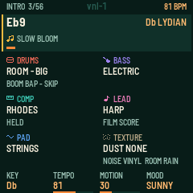
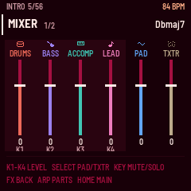

# VNL-1

A generative lo-fi DJ groovebox for the M-VAVE FM-1.

VNL-1 is an experiment in generative music using music theory to create relaxing, realistic lo-fi tracks. Let it play in auto mode as a backdrop to your day, or be the DJ and shape your own songs.

## [Install in your browser](install/)

Version {{VERSION}}. In Chrome or Edge, connect the FM-1 by USB and open the installer. It writes the firmware, then
the sample bank (VNL-1's sampled instruments). Installing is at your own risk; the installer can also put M-VAVE's
own firmware back.

**The sample bank** lives in its own part of the flash, and a firmware update leaves it in place. The installer
offers to write it after the firmware: say yes on a first install, or when a release says the samples changed.
Without it, VNL-1 shows NO SAMPLES and plays its synth instruments only.

Other ways in:

- [Try it in the browser](emu/): the same code the FM-1 runs, with sound. No FM-1 needed.
- [Download {{PKG}}](firmware/{{PKG}}) for the command-line installer: `python3 base/tools/fm1_install.py {{PKG}}`,
  then `python3 tools/fm1_bank.py` for the sample bank (both from the source, with `mido` and `python-rtmidi`).

## What it does

- **Endless songs:** each one generated from a seed, with its own key, tempo, chords, layout and band; 40 instrument
  sets in five flavors, 43 chord progressions, four moods and five song layouts.
- **A six-part band:** drums (8 kits), bass (4 instruments), accompaniment (9 instruments), lead (8 instruments in 8 styles),
  pad and texture.
- **An accompaniment engine:** voice-led chords in eight rhythms, guitars strummed string by string in
  eight patterns, and a harp that strums or rolls its chords.
- **Real and synth sounds:** sampled piano, guitars, cello, harp and drum kits from CC0 libraries, beside modeled and
  synth instruments.
- **Ten sound engines:** a sampler, FM electric piano, FM bass, a wind voice (flute, whistle), an analog-style saw
  pad, an ensemble for strings and choir, a tonewheel organ, a modeled vibraphone, a chip triangle and the drum
  synths.
- **Ten effects** in a lo-fi chain.
- **Hands on:** change the key, tempo, mood or any part from the knobs, re-roll or lock a part, jump to or loop a
  section, mute and solo, and save up to 16 songs; every change lands in time.
- **Fifteen themes:** color schemes for every screen, picked in Settings.
- **On the FM-1:** a now-playing screen, a detailed main screen, a page per part, a screen reader and
  USB audio in and out.
- **For tinkerers:** a workbench web page, a host simulator that renders WAV, MIDI and MusicXML, and patterns as
  editable files.

## Unique to VNL-1

Music theory drives VNL-1's decisions, from the key of the next song to the last note of a phrase.

- **Endless songs:** complete songs with real endings, written on the FM-1 itself, one after another, forever, each with its own key, mode, tempo,
  progression, band and arrangement, a real ending, then a short silence, and each different from the one before.
  Each new song starts in a related key: a fifth away, or the relative major or minor.
- **Chords voiced like a jazz player's:** the bass takes the root, the keys keep the 3rd and 7th, and each chord moves
  to the next by the smallest step, with the top note moving least, even from the loop's last chord back to its
  first. Dominants always carry a 9th or 13th, notes that clash with the chord are left out, and later passes add
  color one chord at a time.
- **Parts that listen to each other:** no part rubs against another. The pad, the lead and the walking bass skip any
  note a half step or a minor 9th from what the others play, and the accompaniment makes room for the lead, thinning
  under it or lifting over a low one.
- **Leads built from real melodies:** eight lead styles drawn from studies of how melodies work: a motif stated and
  then sequenced, chord tones on the strong beats, a bossa line held across the chord change, and phrases that never
  end on a dominant's 7th.
- **A guitarist's strumming:** VNL-1 writes its own strummed guitar part inside each song it generates. It
  voices each chord as a real hand shape on six strings (the root on a low string, fretted notes within four frets,
  open strings where they fit) and plays it with down and up strokes, muted chucks and a bossa thumb and pinch.
- **Deep song planning:** each song is laid out before it plays: a layout, sections, where each part enters and
  drops out, fills, swells, breaks and an ending. No two sections are alike. The seeds and patterns are a starting
  point and the engine reshapes them so every song is its own.
- **Parts planned ahead:** each part's next bar is planned before it plays, so a change from the knobs lands on the
  next four-bar line, in time, with that bar already planned in the new setting.
- **Scores, not just sound:** every part can be written out as MusicXML (and MIDI) for a score editor, and the drum,
  strum, accompaniment and chord patterns live as MIDI and MusicXML files that build into the firmware.

## Videos

**A demo:** VNL-1 walked through on the FM-1.

{{YOUTUBE JQvidnI_M0s VNL-1 demo}}

**Just the music:** VNL-1 playing, no talking.

{{YOUTUBE Gj_xqsksJJs VNL-1, no talking}}

## Screens

**The main screen:** the chord and key beside the turning record, a tile per part, and the four knobs.

**A part's page:** its instrument, rhythm, voicings and register on the knobs.

**Parts:** each part's notes scrolling over the song.

**Sections:** jump to a section, loop it, or stay on the song.

**The Mixer:** a level, mute and solo per part.

**Settings:** the color theme, the bass's saturation and the home screen.

## More

- [Manual](manual/): the screens, the controls, the sample bank.
- [Source](https://github.com/pianomansam/fm1-vnl): the firmware, the host simulator, the workbench and the patterns.
- [Roadmap](https://github.com/pianomansam/fm1-vnl/blob/main/ROADMAP.md) and
  [changelog](https://github.com/pianomansam/fm1-vnl/blob/main/CHANGELOG.md).
- [Credits](https://github.com/pianomansam/fm1-vnl/blob/main/CREDITS.md): everything borrowed, with its author and
  license.

VNL-1 is free software. Its source is GPL-3.0-or-later; the firmware binary is GPL-3.0-only, because it includes
GPL-3.0-only drum engines. It is built on fm1-base and felucca-bsp, from Felucca by Leo Kuroshita (Hügelton
Instruments). The reverb and chorus are adapted from Mutable Instruments Rings by Emilie Gillet (MIT). The samples
are CC0.

M-VAVE and FM-1 are trademarks of their owners. VNL-1 is not affiliated with or endorsed by M-VAVE, Mutable
Instruments or Hügelton Instruments.
