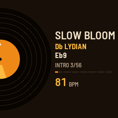
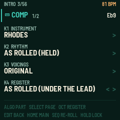
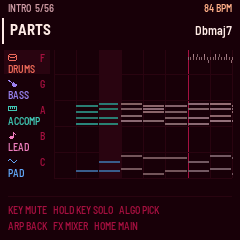
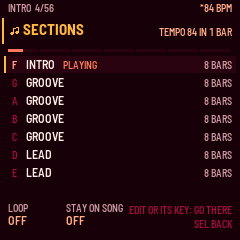
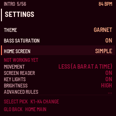

# VNL-1

A generative lo-fi DJ groovebox for the M-VAVE FM-1. Let it play in auto mode as a backdrop to your day, or be the DJ
and shape your own songs.

VNL-1 writes and plays its own songs, one after another: each
has its own key, tempo, chords, layout and band, played through a lo-fi chain of tape wobble, dust and a plate. Press
PLAY and leave it running, or steer it from the knobs. Every change lands on the next four-bar line, in time.

## [Install in your browser](install/)

Version {{VERSION}}. In Chrome or Edge, connect the FM-1 by USB and open the installer. It writes the firmware, then
the sample bank (VNL-1's sampled instruments). Installing is at your own risk; the installer can also put M-VAVE's
own firmware back.

**The sample bank** lives in its own part of the flash, and a firmware update leaves it in place. The installer
offers to write it after the firmware: say yes on a first install, or when a release says the samples changed.
Without it, VNL-1 shows NO SAMPLES and plays its synth instruments only.

Other ways in:

- [Try it in the browser](emu/): the same code the FM-1 runs, with sound. No FM-1 needed.
- [Download {{PKG}}](firmware/{{PKG}}) for the command-line installer: `python3 base/tools/fm1_install.py {{PKG}}`,
  then `python3 tools/fm1_bank.py` for the sample bank (both from the source, with `mido` and `python-rtmidi`).

## What it does

- **Endless songs**, each from a seed, with a short silence between them; or stay on one song as long as you like.
- **40 instrument sets** in five flavors: lo-fi, bossa, city pop, neo-soul and chillwave.
- **44 chord progressions** in six modes, any of 12 keys, 70-90 BPM, swing, and chords that grow richer on later
  passes.
- **Four moods** (sad, wistful, warm, sunny), a Motion control from calm to busy, and five song layouts with intros,
  breaks, drum drops and endings.
- **Six parts:** drums (eight kits, two of them sampled), bass, accompaniment (keys, organ, strummed guitars, harp), lead (eight
  instruments, eight styles, looped like a sample), pad, and texture (dust, vinyl, tape, rain, room).
- **Sampled instruments:** piano, nylon, electric and jazz guitar, cello, harp and two room kits, all from CC0
  libraries; plus vibes, a tonewheel organ and FM and analog-style synths.
- **A lo-fi mix:** wow and flutter, saturation, grit, chorus, delay, a plate reverb, the kick ducking the mix, and a
  whole-mix stutter on the last bar of a 4- or 8-bar group.
- **On the FM-1:** a now-playing screen, a main screen with a tile per part, a page per part, a Parts roll, Sections
  and a Mixer; mute or solo a part from the keys; a screen reader; USB audio in and out.

## Screens

**The main screen:** the chord and key beside the turning record, a tile per part, and the four knobs.

**A part's page:** its instrument, rhythm, voicings and register on the knobs.

**Parts:** each part's notes scrolling over the song.

**Sections:** jump to a section, loop it, or stay on the song.

**The Mixer:** a level, mute and solo per part.

**Settings:** the color theme, the bass's saturation and the home screen.

## More

- [Manual](manual/): the screens, the controls, the sample bank.
- [Source](https://github.com/pianomansam/fm1-vnl): the firmware, the host simulator, the workbench and the patterns.
- [Roadmap](https://github.com/pianomansam/fm1-vnl/blob/main/ROADMAP.md) and
  [changelog](https://github.com/pianomansam/fm1-vnl/blob/main/CHANGELOG.md).
- [Credits](https://github.com/pianomansam/fm1-vnl/blob/main/CREDITS.md): everything borrowed, with its author and
  license.

VNL-1 is free software. Its source is GPL-3.0-or-later; the firmware binary is GPL-3.0-only, because it includes
GPL-3.0-only drum engines. It is built on fm1-base and felucca-bsp, from Felucca by Leo Kuroshita (Hügelton
Instruments). The reverb and chorus are adapted from Mutable Instruments Rings by Emilie Gillet (MIT). The samples
are CC0.

M-VAVE and FM-1 are trademarks of their owners. VNL-1 is not affiliated with or endorsed by M-VAVE, Mutable
Instruments or Hügelton Instruments.
